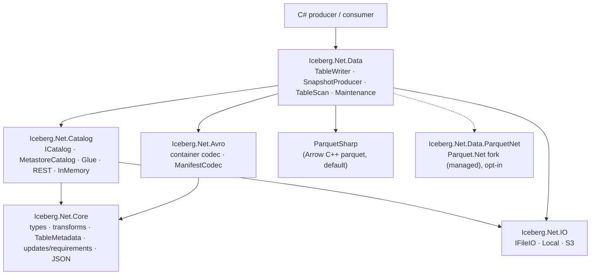
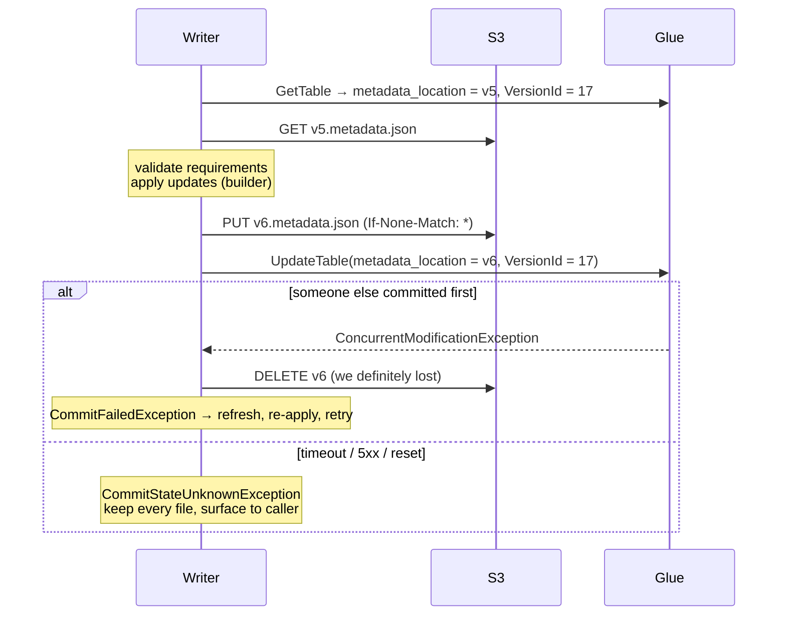

# Architecture

## Layers



Parquet files go through a small backend interface (`IParquetBackend`, `ParquetModel.cs`): the schema tree, column
chunk statistics, and each leaf column as its levels plus its values. The data layer (`ParquetFiles`, `NestedColumns`,
`ParquetInspection`, `ParquetImport`) is written once over it; ParquetSharp is the default backend and Parquet.Net
(`external/parquet-dotnet`, a git submodule) the other, chosen with `ParquetNet.UseAsDefault()` or
`ICEBERG_PARQUET_BACKEND=parquet-net`. Both write the same files and CI runs the suites on both
([parquet-net-gaps.md](parquet-net-gaps.md)).

`Core` has no dependencies at all (BCL only) and is where the spec lives. Everything that talks to the
outside world (AWS SDK, HTTP, Parquet) sits above it, so the spec layer can be tested in microseconds.

## The one idea: metadata is a value, changes are data

Iceberg table state is a single immutable JSON document (`TableMetadata`). Every change is expressed as a
list of `MetadataUpdate`s guarded by a list of `UpdateRequirement`s — exactly the payload of the REST
catalog's `updateTable` call:

```
requirements: [assert-table-uuid, assert-ref-snapshot-id(main = 42)]
updates:      [add-snapshot(43), set-snapshot-ref(main → 43)]
```

That gives one code path for every catalog type:

| Catalog kind | Who validates requirements and applies updates | Atomic step |
|---|---|---|
| REST (Polaris, Unity, S3 Tables, Nessie, Lakekeeper, fixture…) | the server | the HTTP request |
| Metastore (Glue, Hive, JDBC, in-memory) | the client, via `TableMetadataBuilder` | compare-and-swap of the `metadata_location` pointer |

`TableMetadataBuilder` mirrors Java's `TableMetadata.Builder` so a commit produces the same metadata whether
the server or this library applies it. That equivalence is what `CatalogConformanceTests` checks by running
identical scenarios against Glue (client-applied) and the Java REST fixture (server-applied).

## Metastore commit protocol



Three rules come from this, and each is pinned by a test:

1. **Never overwrite a metadata file** — `IFileIO.WriteAsync(overwrite:false)` uses S3 conditional writes
   (`EmulatorFidelityTests.S3_conditional_create_rejects_existing_objects`).
2. **Lost race ⇒ clean up; unknown outcome ⇒ touch nothing** (`CommitProtocolTests`).
3. **The swap must be a real CAS** — Glue `VersionId` (`EmulatorFidelityTests.Glue_update_table_enforces_version_id`).

## Snapshot production and retries

`SnapshotProducer` (append, overwrite, delete-files) writes immutable artefacts first and commits last:

1. New data files (Parquet) — written once.
2. One manifest for added files, with **null snapshot ID and sequence numbers** so it inherits them from
   whichever manifest list finally references it. This makes it reusable across retries.
3. Rewritten manifests (when deleting) and the manifest list — regenerated per attempt, because they depend
   on the parent snapshot.
4. Commit `add-snapshot` + `set-snapshot-ref(main)` with `assert-ref-snapshot-id(main = parent)`.

On `CommitFailedException` it refreshes, rebuilds 3–4 on the new parent and retries with exponential backoff
(`commit.retry.*` table properties, Java defaults). After success it deletes artefacts from failed attempts
that the winning snapshot does not reference. Appends never conflict semantically, so they always succeed
after retry; overwrites currently re-evaluate their predicate against the new parent (snapshot isolation).
Serializable validation for overwrites/deletes (Java's `validateNoConflictingData`) is roadmap item M2.

## Reading

`TableScan.PlanFilesAsync` walks manifest list → manifests → live entries, resolving every column by field ID,
inheriting sequence numbers and row IDs as the spec requires. `ParquetFiles.ReadAsync` projects each file
onto the current schema by field ID; columns added later read as `initial-default` or null. There is no
expression engine yet, so filters are `Func<DataFile,bool>` over partition tuples and metrics.

## Values

Rows are `object?[]` aligned to the schema's top-level columns, holding Iceberg's *physical* values: `int`
days for `date`, `long` micros for `time`/`timestamp(tz)`, `long` nanos for `timestamp_ns`,
`IcebergDecimal` (BigInteger + scale) for decimals, `Guid` for uuid, `byte[]` for binary/fixed; structs are
`object?[]` aligned to their fields, lists `List<object?>`, maps `Dictionary<object, object?>` (any `IEnumerable` /
`IDictionary` is accepted on write). This is deliberately low-level; `Iceberg.Net.Arrow` adds an Arrow
`RecordBatch` surface (nested columns included). Reasons the CLR types are not used directly are in
[libraries.md](libraries.md#clr-type-pitfalls).
